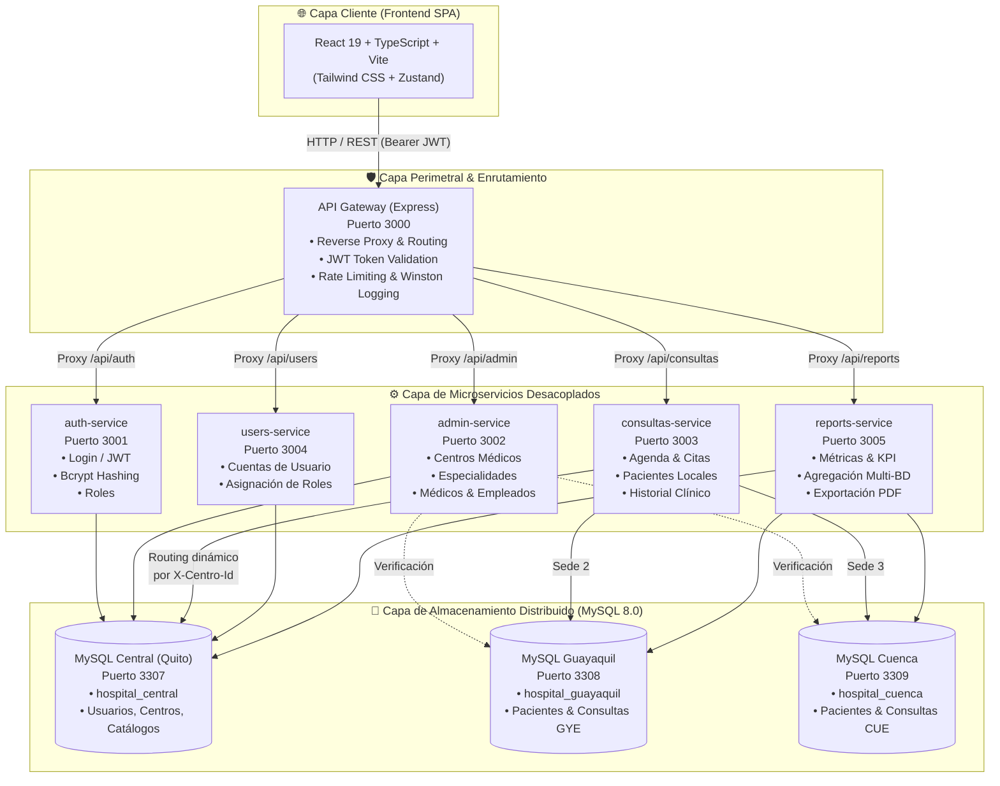
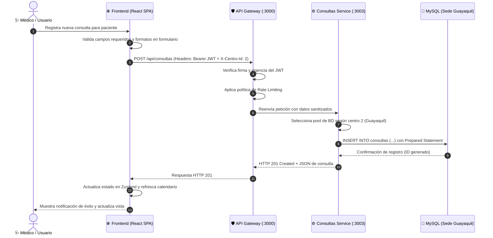

# 🏥 HospitalApp — Guía Completa: ¿Qué es y Cómo Funciona?

[](https://docker.com)
[](https://mysql.com)
[](https://react.dev)
[](https://nodejs.org)
[](https://azure.microsoft.com)

---

## 📌 Tabla de Contenidos
1. [Visión General del Proyecto](#1-visión-general-del-proyecto)
   - [¿Qué es HospitalApp?](#qué-es-hospitalapp)
   - [El Problema del Mundo Real](#el-problema-del-mundo-real)
   - [La Solución de Ingeniería](#la-solución-de-ingeniería)
2. [¿Qué Hace el Programa? (Módulos y Funcionalidades)](#2-qué-hace-el-programa-módulos-y-funcionalidades)
   - [Autenticación y Control de Acceso (RBAC)](#autenticación-y-control-de-acceso-rbac)
   - [Gestión de Consultas Médicas y Agenda](#gestión-de-consultas-médicas-y-agenda)
   - [Gestión de Pacientes e Historias Clínicas](#gestión-de-pacientes-e-historias-clínicas)
   - [Panel de Administración Hospitalaria](#panel-de-administración-hospitalaria)
   - [Analítica Gerencial y Exportación a PDF](#analítica-gerencial-y-exportación-a-pdf)
3. [¿Cómo Funciona por Dentro? (Arquitectura Técnica)](#3-cómo-funciona-por-dentro-arquitectura-técnica)
   - [Diagrama de Arquitectura de Microservicios](#diagrama-de-arquitectura-de-microservicios)
   - [Desglose de Microservicios](#desglose-de-microservicios)
   - [Estrategia de Bases de Datos Distribuidas](#estrategia-de-bases-de-datos-distribuidas)
   - [Flujo de una Petición (End-to-End)](#flujo-de-una-petición-end-to-end)
4. [Flujos de Trabajo Clave (Casos de Uso)](#4-flujos-de-trabajo-clave-casos-de-uso)
5. [Seguridad y Buenas Prácticas](#5-seguridad-y-buenas-prácticas)
6. [Puesta en Marcha Rápida](#6-puesta-en-marcha-rápida)

---

## 1. Visión General del Proyecto

### ¿Qué es HospitalApp?
**HospitalApp** es una plataforma integral de gestión hospitalaria de nivel empresarial diseñada para operar sobre redes de centros médicos distribuidos geográficamente (ejemplo: Sede Central Quito, Sede Guayaquil y Sede Cuenca).

El sistema digitaliza el ciclo completo de atención ambulatoria: desde el agendamiento y atención de citas médicas hasta el control de expedientes de pacientes, administración de especialistas e infraestructura, y la generación de métricas ejecutivas con reportes clínicos descargables.

### El Problema del Mundo Real
Las organizaciones de salud con múltiples clínicas o sedes enfrentan importantes desafíos técnicos y operativos:
- **Latencia de Red:** Las sedes remotas sufren demoras al consultar una única base de datos centralizada.
- **Punto Único de Fallo (SPOF):** Si el servidor central cae, todas las sedes detienen su operación clínica, impidiendo registrar consultas o ver pacientes.
- **Autonomía Regional:** Cada sede necesita gestionar sus citas y pacientes de forma ágil, pero la directiva requiere consolidar estadísticas globales en tiempo real.
- **Soberanía y Aislamiento de Datos:** La información confidencial de salud debe segmentarse adecuadamente para cumplir normativas de privacidad y seguridad médica.

### La Solución de Ingeniería
HospitalApp resuelve estos retos combinando dos pilares arquitectónicos avanzados:
1. **Microservicios Desacoplados:** Cada dominio de negocio (autenticación, administración, consultas, usuarios y analítica) opera como un servicio autónomo, comunicándose a través de un **API Gateway** centralizado que provee proxy inverso, control de rate limiting y validación de tokens.
2. **Bases de Datos Distribuidas Geográficamente:** El almacenamiento de datos está fragmentado horizontal y verticalmente en tres instancias independientes de MySQL (`hospital_central`, `hospital_guayaquil`, `hospital_cuenca`). Cada microservicio enruta dinámicamente sus operaciones hacia el nodo regional correspondiente en función del contexto de la petición (`X-Centro-Id`).

---

## 2. ¿Qué Hace el Programa? (Módulos y Funcionalidades)

### Autenticación y Control de Acceso (RBAC)
- **Inicio de Sesión Seguro:** Autenticación basada en JSON Web Tokens (JWT) con contraseñas encriptadas mediante `bcrypt` (factor de costo 10).
- **Control de Acceso Basado en Roles:**
  - 👑 **Administrador:** Acceso completo a todas las sedes hospitalarias, creación de médicos, asignación de especialidades, alta de personal y configuración global.
  - 🩺 **Médico:** Interfaz optimizada para el día a día clínico; acceso focalizado a las citas y pacientes de su sede asignada, con agenda en tiempo real y registro de diagnósticos.
- **Seguridad en Tiempo Real:** Interceptor HTTP en Axios que inyecta automáticamente el token JWT y detecta expiraciones, redirigiendo al usuario al login y limpiando el estado de sesión sin pérdida de datos.

### Gestión de Consultas Médicas y Agenda
- **Calendario Médico Interactivo:** Visualización dinámica por **Mes**, **Semana**, **Día** y **Agenda**.
- **Ciclo de Vida de la Consulta:**
  ```mermaid
  stateDiagram-v2
      [*] --> Programada: Agendamiento de cita
      Programada --> En_Atencion: Paciente ingresa a consulta
      En_Atencion --> Completada: Diagnóstico y notas registradas
      Programada --> Cancelada: Paciente o médico cancela
      En_Atencion --> Cancelada: Imprevisto durante atención
      Completada --> [*]
      Cancelada --> [*]
  ```
- **Control Clínico:** Registro de fecha y hora, duración estimada y real (hasta 480 minutos con validación), motivo de consulta, diagnóstico clínico y notas de evolución.
- **Filtros Avanzados:** Filtrado por sede, médico especialista, estado de la cita y rango de fechas.

### Gestión de Pacientes e Historias Clínicas
- **Ficha Integral del Paciente:** Nombres completos, cédula de identidad, teléfono, correo electrónico, fecha de nacimiento, género y dirección domiciliaria.
- **Validación de Cédula Ecuatoriana:** Algoritmo estricto de validación basado en el algoritmo Módulo 10 (cédulas válidas de 10 dígitos), evitando registros fraudulentos o erróneos.
- **Aislamiento Territorial:** Cada paciente queda registrado en la base de datos de su centro médico local, optimizando los tiempos de búsqueda y garantizando la autonomía de la sede.

### Panel de Administración Hospitalaria
- **Centros Médicos:** Creación, edición y monitoreo de sedes físicas (Quito, Guayaquil, Cuenca) con información de contacto y geolocalización.
- **Especialidades Médicas:** Catálogo normalizado de ramas médicas (Cardiología, Pediatría, Medicina General, Traumatología, etc.).
- **Personal Médico y Empleados:** Alta de profesionales de la salud, vinculación a especialidades, asignación de centros de atención y horarios.
- **Cuentas y Credenciales:** Gestión centralizada de usuarios del sistema con activación/desactivación instantánea.

### Analítica Gerencial y Exportación a PDF
- **Dashboard Estadístico:** Tarjetas de métricas clave (Total de consultas, citas completadas, porcentaje de efectividad, consultas canceladas).
- **Gráficos Interactivos:** Visualización con Recharts de tendencias de consultas en el tiempo, carga de pacientes por médico y demanda por especialidad.
- **Exportación de Informes Ejecutivos en PDF:** Generación programática de documentos formales vía `jsPDF` y `jspdf-autotable`, que incluyen:
  - Membrete y cabecera corporativa del hospital.
  - Resumen ejecutivo con métricas del período seleccionado.
  - Tabla desglosada de pacientes atendidos y diagnósticos.
  - Pie de página con numeración, fecha de emisión y espacio para firma médica responsable.

---

## 3. ¿Cómo Funciona por Dentro? (Arquitectura Técnica)

### Diagrama de Arquitectura de Microservicios



### Desglose de Microservicios

| Microservicio | Puerto Interno | Responsabilidad Principal | Dependencia de Datos |
|:---|:---:|:---|:---|
| **API Gateway** | `3000` | Punto de entrada unificado, proxy inverso `http-proxy-middleware`, validación de tokens, rate limiting y CORS. | Ninguna directa (enruta a servicios). |
| **Auth Service** | `3001` | Autenticación, generación y validación de tokens JWT, hasheo de contraseñas con bcrypt. | `hospital_central` |
| **Admin Service** | `3002` | Mantenimiento de centros médicos, especialidades, médicos y empleados. | `hospital_central` + validaciones regionales. |
| **Consultas Service** | `3003` | Lógica de negocio para citas médicas, agendas, pacientes y atenciones clínicas. | Dinámica (`hospital_central`, `hospital_guayaquil`, `hospital_cuenca`). |
| **Users Service** | `3004` | Administración de usuarios, estados de cuenta y permisos de acceso. | `hospital_central` |
| **Reports Service** | `3005` | Consultas analíticas consolidadas, cálculo de KPIs y exportación de reportes clínicos. | Consulta federada a las 3 bases de datos. |

### Estrategia de Bases de Datos Distribuidas
El sistema no utiliza un enfoque monolítico con una única base de datos sobrecargada. En su lugar, aplica una estrategia de **bases de datos federadas y particionadas geográficamente**:
1. **Nodo Central (`hospital_central` - Quito):** Almacena las entidades globales compartidas por toda la organización (usuarios del sistema, credenciales, catálogo de especialidades, directores de centro y metadata del sistema).
2. **Nodos Regionales (`hospital_guayaquil`, `hospital_cuenca`):** Almacenan exclusivamente los datos operativos de cada localidad: pacientes atendidos en esa ciudad y las citas médicas registradas en ese centro.
3. **Mecanismo de Conexión Dinámica:** Cada microservicio mantiene un mapa de pools de conexiones persistentes (`mysql2/promise` con reconexión automática). Al recibir una petición, extrae el identificador del centro (`req.headers['x-centro-id']` o `req.query.centro_id`) y ejecuta la consulta SQL en el pool correspondiente, aislando los fallos de una sede del resto del hospital.

### Flujo de una Petición (End-to-End)



---

## 4. Flujos de Trabajo Clave (Casos de Uso)

### Caso 1: Inicio de Jornada y Atención de Consulta por un Médico
1. El médico ingresa sus credenciales en `/login`.
2. El sistema valida su identidad en el `auth-service` y le otorga un JWT que contiene su ID de médico, rol (`medico`) y sede (`id_centro: 2` para Guayaquil).
3. Es redirigido automáticamente a la vista de **Consultas** (`/consultas`), donde el frontend preselecciona su centro y filtra automáticamente sus pacientes y citas.
4. En el calendario, el médico abre la cita de las 09:00 AM, cambia su estado a `en_atencion`, anota las observaciones y diagnóstico, y al terminar marca la consulta como `completada` con su duración real.
5. La consulta se persiste de forma inmediata y exclusiva en la base de datos de Guayaquil (`hospital_guayaquil`).

### Caso 2: Alta de un Nuevo Especialista por el Administrador
1. El administrador inicia sesión y accede al panel `/admin/medicos`.
2. Completa el formulario con nombres, apellidos, cédula ecuatoriana, especialidad (ej. Cardiología) y asigna el médico al centro de Cuenca (`id_centro: 3`).
3. El `admin-service` inserta el perfil profesional en la base de datos central y crea las credenciales de acceso correspondientes.
4. El nuevo médico puede acceder de inmediato a la plataforma y visualizar el panel de su centro asignado.

### Caso 3: Auditoría y Reporte Mensual de Rendimiento
1. El director médico o administrador accede a la sección de **Reportes** (`/reportes`).
2. Selecciona un rango de fechas y elige un centro específico o "Todos los Centros".
3. El `reports-service` realiza consultas paralelas a los nodos involucrados, agrega los totales y calcula métricas clave:
   - Tiempo promedio por consulta.
   - Ratio de asistencia vs. cancelaciones.
   - Carga de trabajo por médico especialista.
4. El usuario presiona **"Exportar a PDF"**; el motor `jsPDF` renderiza un documento formal con diseño institucional, listo para auditoría o impresión.

---

## 5. Seguridad y Buenas Prácticas

- **Prevención de Inyección SQL:** Todas las operaciones de base de datos se ejecutan estrictamente mediante consultas parametrizadas (`Prepared Statements`) a través del driver `mysql2/promise`.
- **Criptografía Robusta:** Hasheo unidireccional de contraseñas con `bcrypt` empleando un factor de costo computacional de 10 rondas de salt.
- **Autorización por Capas:**
  - **Capa Perimetral:** El Gateway verifica el token JWT antes de que la petición toque los microservicios internos.
  - **Capa de Servicio:** Cada endpoint valida permisos y roles requeridos (`admin` vs `medico`).
  - **Capa Cliente:** Las rutas privadas de React están resguardadas por el componente `ProtectedRoute` y custom hooks como `usePermissions` y `useRouteSecurity`.
- **Validación de Datos en Dos Niveles:**
  - **Frontend:** Validación interactiva inmediata (regex de emails, algoritmos de cédula, tipos numéricos).
  - **Backend:** Validación con `express-validator` para rechazar cargas maliciosas antes de procesarlas.
- **Gestión Segura de Configuración:** Ninguna credencial de producción se aloja en el repositorio de código. El proyecto utiliza plantillas `.env.example` y mantiene archivos de entorno ignorados mediante `.gitignore`.
- **Trazabilidad y Observabilidad:** Registro estructurado de logs en formato JSON mediante `Winston`, capturando trazas de error, peticiones entrantes y tiempos de respuesta.

---

## 6. Puesta en Marcha Rápida

Para desplegar localmente el ecosistema completo (Frontend, API Gateway, 5 Microservicios y 3 Bases de Datos MySQL):

```bash
# 1. Clonar el repositorio
git clone https://github.com/T1Angel4220/AD-GestionHospitalaria.git
cd AD-GestionHospitalaria

# 2. Instalar dependencias del script de configuración
npm install

# 3. Ejecutar el orquestador unificado (inicia contenedores, aplica migraciones y levanta la app)
node setup-hospital.js
```

Una vez finalizado el proceso:
- 🌐 **Frontend SPA:** `http://localhost:5173`
- 🛡️ **API Gateway:** `http://localhost:3000`
- 🩺 **Microservicios:** Puertos `3001` al `3005`
- 💾 **Bases de Datos MySQL:** Puertos `3307` (Central), `3308` (Guayaquil) y `3309` (Cuenca)

---

<div align="center">
  <sub>Desarrollado como proyecto de ingeniería de software con arquitectura de sistemas distribuidos de alto impacto.</sub>
</div>
