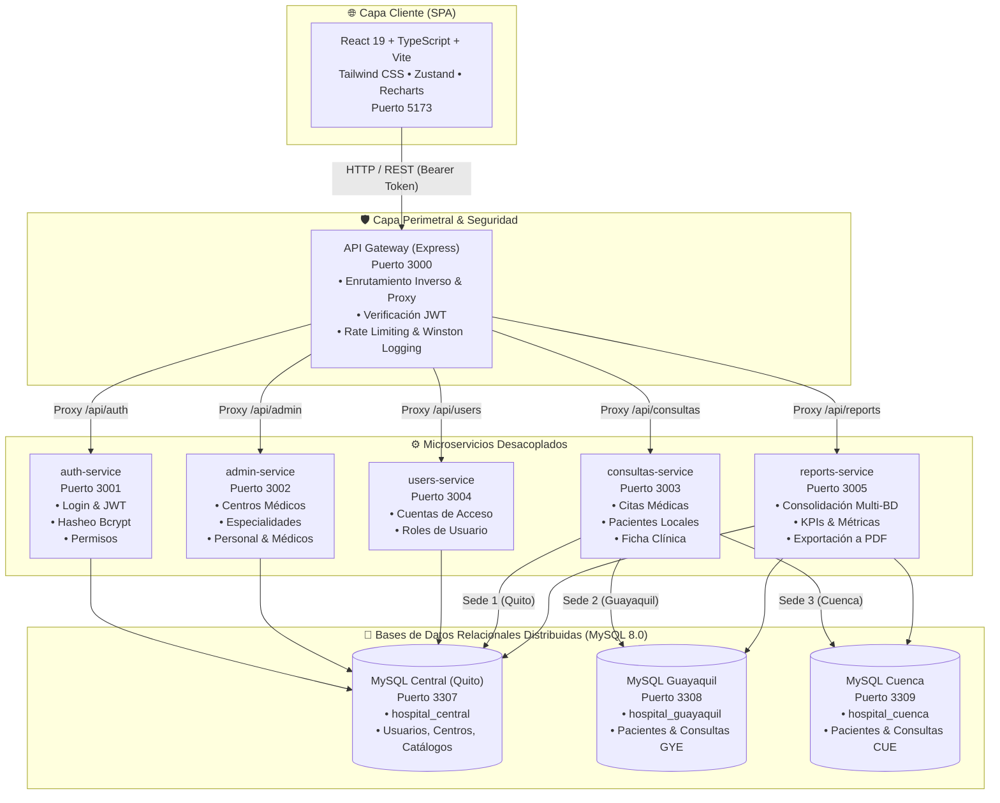

# 🏥 HospitalApp — Plataforma de Gestión Hospitalaria Distribuida

<div align="center">

[](https://nodejs.org/)
[](https://expressjs.com/)
[](https://react.dev/)
[](https://www.typescriptlang.org/)
[](https://www.mysql.com/)
[](https://docker.com/)
[](https://tailwindcss.com/)
[](https://azure.microsoft.com/)

**Sistema de gestión clínica y administrativa multi-sede desarrollado con arquitectura de microservicios, bases de datos relacionales distribuidas geográficamente y frontend reactivo moderno.**

[📖 ¿Qué es y qué hace el programa? (Guía Detallada)](PROYECTO_EXPLICACION.md) • [🏗️ Arquitectura](#-arquitectura-del-sistema) • [🚀 Inicio Rápido](#-inicio-rápido) • [🛡️ Seguridad](#-seguridad-y-variables-de-entorno) • [📚 Documentación](#-centro-de-documentación)

</div>

---

## 📌 Resumen Ejecutivo

**HospitalApp** es una solución de software empresarial diseñada para redes hospitalarias que operan en múltiples centros de salud distribuidos regionalmente (**Sede Central Quito, Sede Guayaquil y Sede Cuenca**).

El sistema resuelve la complejidad del aislamiento geográfico y la sincronización de datos de salud mediante:
- **Arquitectura de Microservicios:** 5 servicios de dominio desacoplados orquestados por un **API Gateway** centralizado.
- **Bases de Datos Distribuidas:** Fragmentación de datos en 3 instancias independientes de MySQL 8.0, garantizando autonomía operativa regional y alta resiliencia.
- **Frontend SPA Reactivo:** Desarrollado con **React 19**, **TypeScript**, **Vite** y **Tailwind CSS**, con interfaces especializadas según el rol de usuario (Administrador Global vs. Médico de Centro).
- **Seguridad Corporativa:** Autenticación JWT stateless, RBAC (Role-Based Access Control), validación de cédula ecuatoriana (Módulo 10), protección contra inyecciones SQL mediante consultas parametrizadas y rate limiting.
- **Analítica y Reportes:** Cuadro de mandos con gráficos interactivos en Recharts y exportación programática de expedientes en **PDF formal** con firmas de auditoría.

> 💡 **¿Buscas una explicación detallada del modelo de negocio, flujos clínicos y funcionamiento interno?**  
> Consulta la guía completa en [PROYECTO_EXPLICACION.md](PROYECTO_EXPLICACION.md).

---

## 🏗️ Arquitectura del Sistema

### Diagrama de Topología General



---

## 🧩 Catálogo de Microservicios y Endpoints

| Microservicio | Puerto | Responsabilidad de Dominio | Base de Datos Objetivo | Endpoints Principales |
|:---|:---:|:---|:---|:---|
| **API Gateway** | `3000` | Punto de entrada único, proxy inverso, validación central de JWT y control de flujo. | N/A (Enruta a microservicios) | `/api/health`, `/api/*` |
| **Auth Service** | `3001` | Autenticación, generación y verificación de JWT, encriptación `bcrypt` y logout. | `hospital_central` | `POST /login`<br>`POST /verify`<br>`POST /refresh` |
| **Admin Service** | `3002` | Mantenimiento de centros médicos, especialidades clínicas, médicos y personal. | `hospital_central` | `GET/POST /medicos`<br>`GET/POST /centros`<br>`GET/POST /especialidades` |
| **Consultas Service** | `3003` | Ciclo de vida de consultas médicas, citas en calendario y fichas de pacientes. | Enrutamiento dinámico según `X-Centro-Id` | `GET/POST /consultas`<br>`PUT /consultas/:id`<br>`GET/POST /pacientes` |
| **Users Service** | `3004` | Gestión de cuentas de usuario, asignación de roles y estados operativos. | `hospital_central` | `GET/POST /users`<br>`PUT /users/:id`<br>`DELETE /users/:id` |
| **Reports Service** | `3005` | Análisis estadístico multi-sede, consolidación de indicadores y exportación a PDF. | `hospital_central`<br>`hospital_guayaquil`<br>`hospital_cuenca` | `GET /stats`<br>`GET /pacientes-frecuentes`<br>`GET /pdf` |

---

## 🌐 Bases de Datos Distribuidas Geográficamente

El sistema implementa una **partición geográfica de datos** para optimizar el rendimiento y garantizar la continuidad operativa local:

1. **`hospital_central` (Sede Quito - Puerto 3307):**
   - Catálogo global de centros médicos y especialidades.
   - Tabla unificada de usuarios, credenciales y roles.
   - Directorio de médicos y empleados a nivel nacional.
   - Registro local de consultas y pacientes de la sede Quito.
2. **`hospital_guayaquil` (Sede Guayaquil - Puerto 3308):**
   - Registro aislado de pacientes residentes en Guayaquil.
   - Agenda médica y citas del centro Guayaquil.
3. **`hospital_cuenca` (Sede Cuenca - Puerto 3309):**
   - Registro aislado de pacientes residentes en Cuenca.
   - Agenda médica y citas del centro Cuenca.

**Resolución Dinámica de Conexión:**  
Los microservicios analizan la cabecera HTTP `X-Centro-Id` o el parámetro de consulta. A través de pools de conexiones persistentes con `mysql2/promise`, la consulta se redirige en memoria al contenedor MySQL correspondiente en tiempo constante $O(1)$.

---

## 💻 Stack Tecnológico

### Frontend
- **React 19.1.1** — Biblioteca de interfaz basada en componentes funcionales modernos y Hooks.
- **TypeScript 5.8.3** — Tipado estático riguroso en modelos, APIs y componentes.
- **Vite 7.1.2** — Bundler de última generación para compilación ultrarrápida y Hot Module Replacement.
- **Tailwind CSS 4.1.13** — Estilos basados en utilidades con diseño responsivo y tema visual clínico.
- **Zustand 5.0.8** — Gestión de estado global ligera, predecible y sin boilerplate innecesario.
- **Recharts 3.2.1** — Gráficos SVG interactivos para análisis estadístico.
- **React Big Calendar 1.19.4** — Visualizador de agenda clínica por mes, semana, día y vista compacta.
- **jsPDF 3.0.3 & AutoTable** — Motor de generación de reportes clínicos y ejecutivos en PDF.
- **Lucide React** — Set moderno de iconografía vectorial.

### Backend y Microservicios
- **Node.js 18+ (LTS)** — Entorno de ejecución JavaScript del lado del servidor.
- **Express.js 5.1.0** — Framework web minimalist y flexible para construcción de APIs RESTful.
- **MySQL2 3.15.0** — Driver de alto rendimiento con soporte nativo de Promises y connection pooling.
- **JSON Web Token (JWT) 9.0.2** — Autenticación stateless segura con firmas criptográficas.
- **Bcryptjs 3.0.2** — Algoritmo de hash adaptativo para contraseñas con salt round 10.
- **Express Validator 7.0.1** — Sanitización y validación declarativa de datos de entrada.
- **Express Rate Limit 7.1.5** — Protección contra ataques de fuerza bruta y abusos de API.
- **Winston 3.11.0** — Sistema de logging estructurado con rotación de archivos.

### Infraestructura y DevOps
- **Docker 24+ & Docker Compose** — Containerización completa de servicios y bases de datos.
- **Nginx** — Reverse proxy y servidor web estático de producción con soporte SSL/TLS.
- **Microsoft Azure** — Topología de producción sobre 4 Máquinas Virtuales en red virtual privada (VNet).

---

## 📂 Estructura del Repositorio

```
AD-GestionHospitalaria/
├── 📄 PROYECTO_EXPLICACION.md         # 📘 Guía técnica y funcional detallada
├── 📄 README.md                      # 📕 Documentación principal del repositorio
├── 📄 setup-hospital.js              # ⚡ Orquestador unificado de inicio local
├── 📄 package.json                   # Dependencias del script de orquestación
├── 📄 .gitignore                     # Exclusión estricta de secrets, envs y temporales
│
└── 📁 hospital-app/                  # Código fuente del sistema
    ├── 📄 README_SEGURIDAD.md        # Documentación de autenticación y seguridad
    ├── 📄 README_VALIDACIONES.md     # Catálogo de validaciones de negocio y datos
    │
    ├── 📁 frontend/                  # Cliente Web (SPA)
    │   └── 📁 vite-project/          # Proyecto React + TypeScript + Vite
    │       ├── 📁 src/
    │       │   ├── 📁 api/           # Clientes HTTP con interceptores Axios
    │       │   ├── 📁 components/    # Componentes UI (Calendario, Tablas, Modales)
    │       │   ├── 📁 contexts/      # Contextos de React (AuthContext, CentroContext)
    │       │   ├── 📁 hooks/         # Custom Hooks (usePermissions, useRouteSecurity)
    │       │   ├── 📁 pages/         # Páginas (Consultas, Pacientes, Reportes, etc.)
    │       │   ├── 📁 store/         # Estado global con Zustand
    │       │   └── 📁 types/         # Interfaces y tipos de TypeScript
    │       ├── 📄 .env.example       # Plantilla de variables de entorno frontend
    │       └── 📄 Dockerfile         # Imagen optimizada con Nginx multi-stage
    │
    ├── 📁 microservices/             # Servicios Backend
    │   ├── 📁 api-gateway/           # Punto único de entrada (Puerto 3000)
    │   ├── 📁 auth-service/          # Autenticación y JWT (Puerto 3001)
    │   ├── 📁 admin-service/         # Gestión de entidades maestras (Puerto 3002)
    │   ├── 📁 consultas-service/     # Gestión clínica y pacientes (Puerto 3003)
    │   ├── 📁 users-service/         # Administración de accesos (Puerto 3004)
    │   ├── 📁 reports-service/       # Analítica y generación PDF (Puerto 3005)
    │   │
    │   ├── 📁 sql/                   # Esquemas y semillas SQL para MySQL 8.0
    │   │   ├── central.sql           # Estructura DB Central (Quito)
    │   │   ├── guayaquil.sql         # Estructura DB Guayaquil
    │   │   ├── cuenca.sql            # Estructura DB Cuenca
    │   │   └── configure-utf8.sql    # Configuración UTF-8 mb4
    │   │
    │   ├── 📄 docker-compose.yml     # Orquestación de contenedores y redes
    │   ├── 📄 insert-sample-data.js  # Semillero de datos de demostración
    │   └── 📄 reset-databases.js     # Script de limpieza y reinicio de esquemas
    │
    └── 📁 azure/                     # Configuración de despliegue en la nube
        ├── 📄 README_AZURE_DEPLOY.md # Guía paso a paso de despliegue en Azure
        ├── 📁 compose/               # Docker Compose modulares por VM
        ├── 📁 env/                   # Plantillas de variables de entorno (.sample)
        └── 📁 nginx/                 # Archivos de configuración para Nginx
```

---

## 🚀 Inicio Rápido

### Prerrequisitos
- [Node.js](https://nodejs.org/) v18+ instalado.
- [Docker Desktop](https://www.docker.com/) o Docker Engine v24+ en ejecución.
- Git instalado.

### 1. Clonar el Repositorio
```bash
git clone https://github.com/T1Angel4220/AD-GestionHospitalaria.git
cd AD-GestionHospitalaria
```

### 2. Configurar Variables de Entorno
El repositorio incluye archivos `.env.example` en cada módulo para evitar la exposición de credenciales sensibles.

Para iniciar localmente con Docker Compose no se requiere configuración manual adicional, ya que `docker-compose.yml` preconfigura las variables de red interna automáticamente. Si deseas ejecutar microservicios de forma individual fuera de Docker:
```bash
# Copia la plantilla en el servicio correspondiente
cp hospital-app/microservices/api-gateway/env.example hospital-app/microservices/api-gateway/.env
cp hospital-app/frontend/vite-project/.env.example hospital-app/frontend/vite-project/.env
```

### 3. Puesta en Marcha con Script Unificado (Recomendado)
El proyecto incluye un script de automatización que levanta los contenedores Docker, inicializa las bases de datos con sus esquemas, carga datos de prueba e inicia el frontend:

```bash
# Instalar dependencias del orquestador
npm install

# Ejecutar el orquestador
node setup-hospital.js
```

### 4. Puesta en Marcha Manual con Docker Compose
Si prefieres iniciar los servicios manualmente paso a paso:

```bash
# 1. Levantar bases de datos y microservicios
cd hospital-app/microservices
docker compose up -d

# 2. Inicializar esquemas y datos de prueba
node reset-databases.js
node insert-sample-data.js

# 3. Iniciar el frontend
cd ../frontend/vite-project
npm install
npm run dev
```

### 5. Acceso a la Aplicación
Una vez inicializado el sistema:
- 🌐 **Frontend de la Aplicación:** [http://localhost:5173](http://localhost:5173)
- 🛡️ **API Gateway:** [http://localhost:3000](http://localhost:3000)
- 🩺 **Microservicios Backend:** Puertos `3001` (Auth), `3002` (Admin), `3003` (Consultas), `3004` (Users), `3005` (Reports)
- 💾 **Bases de Datos MySQL:** Puertos `3307` (Central), `3308` (Guayaquil), `3309` (Cuenca)

---

## 🔑 Credenciales de Demostración

El sistema se inicializa con cuentas de demostración preconfiguradas:

| Rol | Correo Electrónico | Contraseña por Defecto | Sede / Centro Médico | Vistas Disponibles |
|:---|:---|:---|:---|:---|
| **Administrador** | `admin@hospital.com` | `admin123` | Acceso a todas las sedes | Panel Admin, Médicos, Especialidades, Centros, Usuarios, Reportes |
| **Médico (Quito)** | `medico.central@hospital.com` | `medico123` | Hospital Central Quito | Consultas, Pacientes, Calendario Clínico, Perfil |
| **Médico (Guayaquil)** | `medico.gye@hospital.com` | `medico123` | Hospital Guayaquil | Consultas, Pacientes, Calendario Clínico, Perfil |
| **Médico (Cuenca)** | `medico.cuenca@hospital.com` | `medico123` | Hospital Cuenca | Consultas, Pacientes, Calendario Clínico, Perfil |

---

## 🛡️ Seguridad y Variables de Entorno

Este repositorio sigue rigurosas directrices de seguridad para proyectos profesionales:
- 🚫 **Cero Secretos en el Repositorio:** Ninguna clave privada, secret de JWT ni credencial de producción está commiteada en el control de versiones.
- 📄 **Plantillas `.env.example`:** Todos los microservicios y ambientes en la nube disponen de plantillas `.sample` y `.example` con valores de muestra seguros.
- 🔒 **`.gitignore` Exhaustivo:** Bloquea de manera automática archivos `.env`, `.env.local`, respaldos (`*.bak`), volcados temporales y archivos comprimidos (`*.zip`, `*.rar`, `*.tar.gz`).
- 🛡️ **Validación de Datos y Sanitización:** Los controladores utilizan `express-validator` para prevenir inyecciones SQL y ataques XSS.
- ⚡ **Rate Limiting:** El API Gateway limita el volumen de peticiones concurrentes para mitigar ataques de denegación de servicio (DoS) y fuerza bruta en `/login`.

Para detalles técnicos sobre la implementación de tokens JWT, middlewares de rol e interceptores en el frontend, consulta la [Guía de Seguridad](hospital-app/README_SEGURIDAD.md).

---

## ☁️ Despliegue en la Nube (Azure Multi-VM)

El proyecto está preparado para su despliegue en producción sobre **Microsoft Azure** utilizando una arquitectura aislada en red virtual (**VNet**) con 4 Máquinas Virtuales:

```
[ Internet ]
     │
     ├──► [ VM4: Frontend ] Nginx sirviendo React SPA build (dist/)
     │
     └──► [ VM3: Perímetro ] Nginx HTTPS Proxy ──► API Gateway (:3000) + Auth Service (:3001)
                                                       │ (Red Privada 10.10.1.0/24)
                                                       ├──► [ VM2: Servicios ] Admin, Consultas, Users, Reports
                                                       │         │
                                                       └─────────┴──► [ VM1: DBs ] 3 Contenedores MySQL con volúmenes persistentes
```

Para ver el paso a paso de aprovisionamiento con Azure CLI, certificados SSL con Certbot y scripts de instalación de Docker, consulta la [Guía de Despliegue en Azure](hospital-app/azure/README_AZURE_DEPLOY.md).

---

## 📚 Centro de Documentación

| Documento | Descripción | Audiencia |
|:---|:---|:---|
| 📘 **[PROYECTO_EXPLICACION.md](PROYECTO_EXPLICACION.md)** | **Explicación completa de negocio y arquitectura técnica: qué hace y cómo funciona.** | Evaluadores, Reclutadores, Arquitectos |
| 🛡️ **[README_SEGURIDAD.md](hospital-app/README_SEGURIDAD.md)** | Autenticación JWT, hooks de permisos, interceptores de API y control de rutas. | Desarrolladores Backend & Seguridad |
| 📋 **[README_VALIDACIONES.md](hospital-app/README_VALIDACIONES.md)** | Catálogo de reglas de negocio, validación de cédulas, fechas y tipos de datos. | Desarrolladores QA & Full Stack |
| 🎨 **[FRONTEND_DOCUMENTATION.md](hospital-app/frontend/FRONTEND_DOCUMENTATION.md)** | Arquitectura de componentes React, Zustand store, Tailwind CSS y Recharts. | Desarrolladores Frontend |
| ⚙️ **[README_MICROSERVICES.md](hospital-app/microservices/README_MICROSERVICES.md)** | Guía técnica interna de cada microservicio, puertos, variables y docker-compose. | Desarrolladores Backend & DevOps |
| ☁️ **[README_AZURE_DEPLOY.md](hospital-app/azure/README_AZURE_DEPLOY.md)** | Guía de despliegue en Microsoft Azure con 4 Máquinas Virtuales y VNet privada. | DevOps & Cloud Engineers |

---
